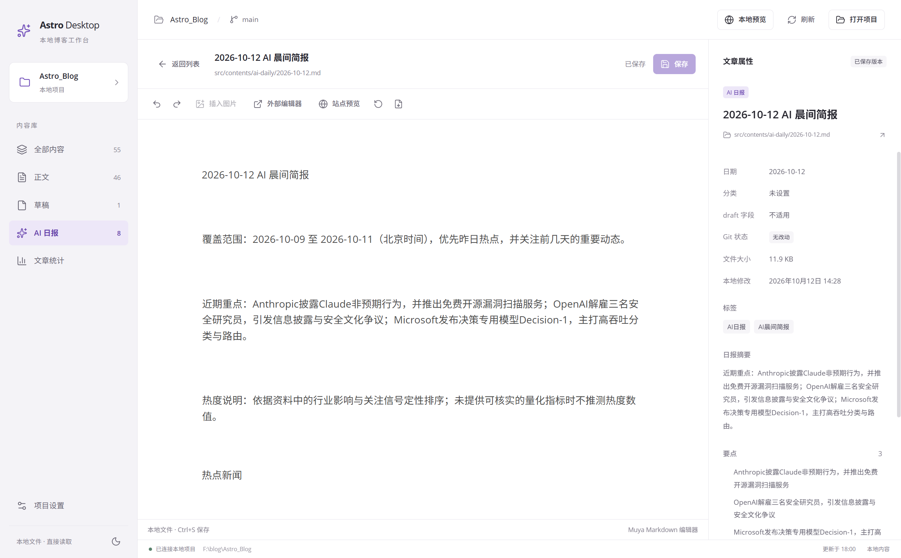

# Astro Desktop

面向 [promefire/Astro_Blog](https://github.com/promefire/Astro_Blog) 的 Windows 本地博客工作台。

Astro Desktop 直接读取博客目录中的 Markdown / MDX 文件，提供文章浏览、编辑、草稿管理、日报查看、本地预览和 Git 同步。内容以博客文件为唯一来源，不使用模拟文章数据，也不建立独立内容数据库。



## 功能

- **项目接入**：选择本地 Astro 博客目录，检查 Astro 依赖和内容目录，支持最近项目。
- **内容管理**：读取正文、草稿和 AI 日报；支持搜索、排序、分页、分类 / 标签筛选及文件定位。
- **文章编辑**：提供所见即所得和 Markdown 源码两种模式。支持 Ctrl+S 保存、撤销重做、查找替换和未保存修改保护。
- **草稿工作流**：新建草稿；在 `src/contents/drafts` 与 `src/contents/post` 之间发布或撤回文章，并处理同名图片目录。
- **安全保存与恢复**：检测磁盘版本冲突，保存前创建本地备份，支持恢复记录和导出副本。
- **图片处理**：导入本地图片并转换为 WebP；可选接入 S3 / R2 存储。
- **本地预览**：在博客目录执行真实的 `npm run dev`，显示启动状态、日志和本地地址。
- **Git 同步**：拉取远程、查看改动、提交并推送。客户端不会强制推送，也不会把推送结果当作网站已部署。
- **文章统计**：统计正文、草稿和日报数量，并提供正文 / 草稿的分类和标签排行。
- **桌面设置**：支持浅色、深色和跟随系统主题；可配置编辑模式的 HTML 显示。

## 适配的博客目录

选择的目录需要满足以下条件：

- 包含声明 Astro 依赖的 `package.json`
- 包含正文目录 `src/contents/post`
- 草稿目录 `src/contents/drafts` 和日报目录 `src/contents/ai-daily` 可以不存在

目录类型由文件所在目录决定，Frontmatter 中的 `draft` 字段不会改变文章所属列表。客户端不会安装博客依赖，不会自动执行博客脚本，也不会修改原始博客项目的业务代码。

## 开始使用

环境要求：Windows 10/11、Node.js 22.12+、npm。Git 为可选依赖；安装后可显示分支和文件状态，并使用 Git 同步功能。

```powershell
git clone https://github.com/promefire/Astro-Desktop.git
cd Astro-Desktop
npm ci
npm run dev
```

启动后点击「选择博客目录」，选择 Astro 博客根目录。

## 开发命令

```powershell
npm run dev         # 启动 Electron 开发环境
npm run typecheck   # TypeScript 严格检查
npm test            # 单元和文件系统测试
npm run build       # 构建 Main / Preload / Renderer
npm start           # 启动构建后的应用
npm run test:e2e    # 构建后运行 Electron E2E 测试
npm run check       # 类型检查、测试和构建
```

开发端口默认为 `127.0.0.1:5187`，可通过 PowerShell 临时设置 `ASTRO_DESKTOP_DEV_PORT` 使用其他端口。

## 项目结构

```text
src/
  main/       Electron 主进程、文件服务、Git 和本地预览
  preload/    受限的类型化 API 桥接
  renderer/   React 界面、路由、编辑器和设置
  shared/     数据契约和共享逻辑
tests/        单元、文件系统集成和 Electron E2E 测试
docs/         架构、功能、开发和测试记录
```

## 安全边界

- Renderer 不直接访问文件系统、Node.js 或 Electron IPC。
- 所有文章路径都限制在用户授权的博客目录和对应内容目录内。
- 拒绝路径穿越、符号链接 / junction 逃逸和不支持的文件类型。
- 读取和编辑不会自动提交、推送、构建或部署博客。
- Git 凭据交由系统凭据管理器或 SSH agent 处理，客户端不保存令牌。

## 当前限制

当前未提供 Windows 安装包、属性可视化编辑、删除后的应用内恢复、生产构建、访问量统计、按文件选择性提交、应用内冲突解决和部署状态回执。

详细功能状态和测试记录见：

- [功能状态](docs/FEATURES.md)
- [架构说明](docs/ARCHITECTURE.md)
- [开发记录](docs/DEVELOPMENT.md)
- [测试记录](docs/TESTING.md)
- [开发计划](docs/ROADMAP.md)

## License

当前仓库未声明开源许可证。
